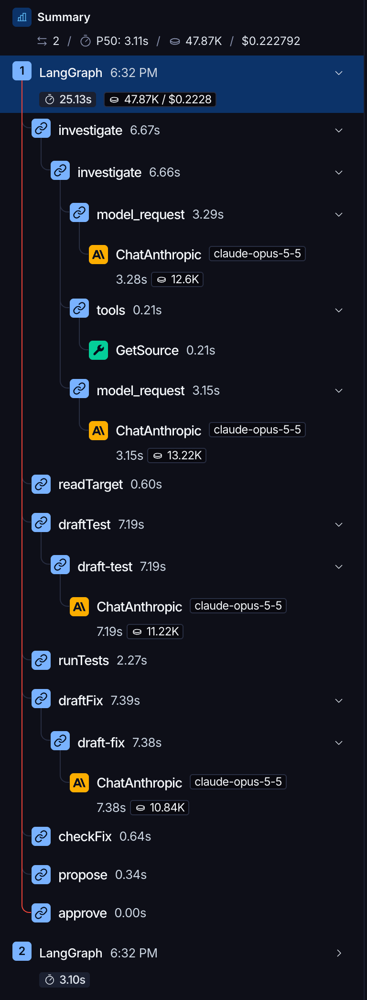

# dump-watcher

An AI agent that repairs ABAP short dumps, with a human on the Approve button.

A click in a Fiori app ends in a short dump. Within about a minute, your phone shows the cause, a unit test that reproduces the dump, and a proposed fix. Tap Approve and the watcher writes the fix, activates it and reruns the tests. The fix is applied only after that tap. Before it, the class's test include already holds the test that reproduces the dump.

This is a proof of concept for **lab and trial systems only**. It writes ABAP code after approval. Never point it at a system you care about.

## How it works

1. **Noticing a dump without polling.** The watcher runs `tail -F` over SSH on the work process traces (`dev_w*`). When the kernel logs `RABAX: level LEV_RX_ERROR_SAVE completed`, the watcher reads SAP's ADT dump feed every 2 s for up to a minute. A check every 5 minutes and a 24-hour catch-up at startup are the safety net.
2. **The agent.** For each new dump of the demo user, the watcher starts Claude Code in headless mode, with [`agent/dump-repair.md`](agent/dump-repair.md) as its playbook. The agent reads the code and its history, writes a unit test that reproduces the dump, drafts a fix and syntax-checks it. It never writes the fix itself.
3. **The checks.** The watcher, not the agent, verifies the proposal: the object is in the lab package, the fix is bound to the SHA-256 hash of the source the agent read, there's no catch-all handler or removed `RAISE SHORTDUMP`, and the test contract holds (the new test fails with the same runtime error, existing tests pass).
4. **The phone.** The watcher pushes a summary to a private [ntfy](https://ntfy.sh) topic. The link opens a proposal page that listens only on the Mac's Tailscale address. Approve and Reject carry a one-time token that expires after an hour.
5. **Apply and verify.** After Approve, the watcher writes the fix, activates it and reruns the tests. If they fail, it restores the old source and verifies the restore. A CDS fix has no unit test, so it waits for a human re-click in the app instead.

When the cause is data rather than code, the agent says so, and the phone shows the missing entry with no Approve button.

## Guardrails

- **One door to SAP:** the agent reaches SAP only through [vsp](https://github.com/oisee/vibing-steampunk), started with writes limited to `$ZDUMP_LAB`, free SQL blocked, and deletes and transport changes disabled (`.mcp.json`).
- **A short allow-list:** 12 tools (`agent/settings.json`); every other tool is denied (`--permission-mode dontAsk`).
- **A guard on every write:** a PreToolUse hook (`agent/lab-guard.mjs`) lets the agent write only the test-class include of a lab class and activate lab classes.
- **Hash binding, test contract and verified restore:** in `core.mjs`, covered by `npm test`.

## Two engines

The watcher has two interchangeable engines behind the same intake, approval page, tokens and SAP checks:

- **Claude Code (default):** `node watcher.mjs` runs Claude Code headless with a playbook, a tool allow-list and a write guard (v1).
- **LangGraph:** `node watcher.mjs --engine langgraph` runs an explicit LangGraph pipeline. The model investigates with 7 read-only tools and drafts text. Code writes the test and the fix, checks the test contract, and owns both retry limits ([diagram](docs/graph.md)).

What moved from the prompt into code:

- The test contract is checked in code, and a failure goes back to the model, up to 3 attempts for the test and 2 for the fix. v1 can only mark a broken answer `unsure`.
- The model has no write tools. Code appends its test class to the original test include, so the existing tests can't change. v1 relies on the playbook for that.
- Approval and the re-click are durable LangGraph pauses (`interrupt()` with a SQLite checkpointer). A watcher killed at any point continues where it stopped. A decision tapped just before a crash is delivered after the restart.

Run it:

```bash
node watcher.mjs --engine langgraph
```

It needs `ANTHROPIC_API_KEY`, in the environment or in the gitignored `.env`; every run is billed to that key. The Claude Code engine never receives it and keeps running on the Claude Code sign-in. `AGENT_MODEL` in `.env` sets the model for both engines. `LANGSMITH_API_KEY` is optional and turns on tracing; the project stays private. Run `node watcher.mjs reset` between two analyses of the same class: the LangGraph engine refuses to analyze while the test include still holds `ltc_dump_repro`.

Each run needs the lab to itself: verify the reset and run exactly one watcher. Nobody else may edit any part of the target objects until the run finishes, including approval waits, re-clicks and crash recovery. Concurrent editing is not supported.

**Comparison of these two implementations.** Both used the same model (`claude-opus-5-5`) on the same lab, with 3 rehearsals per case. Prompts, tools and the agent loop differ, so this compares two implementations, not LangGraph against Claude Code. Each cell gives the median for the code bug / the value help / the data case.

| | Claude Code engine | LangGraph engine |
|---|---|---|
| Detected after (s) | 14 / 12 / 17 | 14 / 14 / 12 |
| Notification after detection (s) | 58 / 44 / 32 | 25 / 21 / 8 |
| Approve → result (s) | 4 / 10 / n/a | 3 / 8 / n/a |
| Model calls · tokens · cost per case | 8 · 346k · $0.28 / 8 · 307k · $0.28 / 5 · 168k · $0.17 | 4 · 48k · $0.22 / 4 · 72k · $0.31 / 2 · 27k · $0.12 |
| Attempts until the test reproduced the dump | 1 / n/a / n/a | 1 / n/a / n/a |
| Kill right after the write (`CRASH_AFTER=writeFix`) | recovery_required | Fixed ✅ after restart |
| Orchestration size (lines) | 129 code + 53 playbook | 442 code + 55 prompts |

For the Claude Code engine, model calls are the agent's turns and the tokens include cached input. Costs are each tool's own estimate: Claude Code's `total_cost_usd` (that engine runs on the Claude Code sign-in) and LangSmith's (billed to the API key). Every run is in the [rehearsal log](docs/rehearsal-log.md).



## Requirements

- SAP ABAP Cloud Developer Trial (A4H) in Docker. The container name `a4h25` and the trace path are set in `watcher.mjs` (`TRACE_ARGS`).
- [vsp](https://github.com/oisee/vibing-steampunk) on the Docker host, configured with your SAP connection in `/root/.env`.
- An SSH alias `vps` in `~/.ssh/config` for the Docker host, with key login and rights to run `docker exec` and `vsp`.
- Node.js 22 or later, and [Claude Code](https://claude.com/claude-code) signed in on the machine that runs the watcher.
- The ntfy app on your phone, and Tailscale on both the phone and the machine that runs the watcher. Developed on macOS.

## Setup

1. `npm install`
2. `cp .env.example .env`, then set `NTFY_TOPIC` to a random name (`echo "dump-watcher-$(openssl rand -hex 6)"`) and subscribe to it in the ntfy app. Keep the topic name private.
3. In SAP, create the local package `$ZDUMP_LAB` with the objects in `lab/`: the tables from `lab/tables.json`, the CDS views, behavior definitions, classes and the service definition. Add an OData V4 UI service binding `ZSB_DL_ORDER_O4` and publish it. Run `ZDL_SEED` once.
4. Create a user `DEMO` in SU01 as a copy of `DEVELOPER`. The watcher ignores dumps of other users.
5. `node watcher.mjs reset` puts the lab back to its broken baseline.

## Run

```bash
node watcher.mjs
```

Then open the binding's Fiori Elements preview in a private window as `DEMO` (log off any other session first). Opening the app triggers the value-help case, Recalculate on order 1 the code bug, and Recalculate on order 3 the data case.

Other commands: `node watcher.mjs analyze <dump-id>` runs the agent on one dump without a notification; `node watcher.mjs reset` restores the lab; `npm test` runs the test suite. `CRASH_AFTER=<point> node watcher.mjs …` kills the watcher at a crash point, for the crash rehearsals: `decision`, `beforePush`, `push`, `testInclude`, `writeFix`, `restoreOriginal`, `enter:<step>` or `threadEnd`.

More detail: the design spec in [`docs/superpowers/specs/`](docs/superpowers/specs/2026-10-01-dump-watcher-design.md) and the [rehearsal log](docs/rehearsal-log.md).

## Credits

[vibing-steampunk (vsp)](https://github.com/oisee/vibing-steampunk) by Alice Vinogradova provides the MCP server for ABAP Development Tools.

[LangGraph.js and LangChain.js](https://github.com/langchain-ai/langgraphjs) by LangChain.

## License

[MIT](LICENSE)
